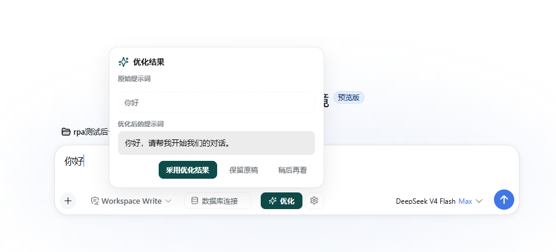
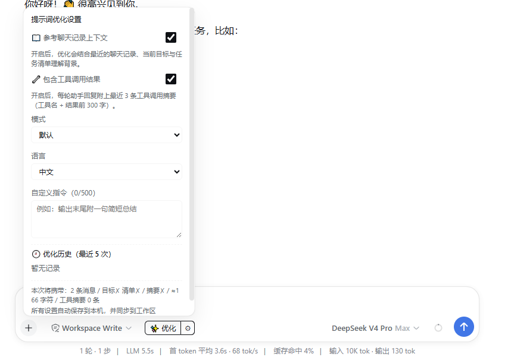

# dsh-prompt-polish

English | [中文](README.zh-CN.md)

Input-bar prompt optimizer for DeepSeek Harness (DSH): an **Optimize** button that rewrites your draft into a clearer, more specific, more executable prompt — optionally grounded in the current session's context.

- 6 strategies × 3 languages plus custom instructions
- Optional context: goal, todo list, compaction summary, tool results, conversation history
- Two-level settings: quick popover (context toggles + mode/language) and a full dialog (custom instructions, carry stats, history, persistence note)
- Result confirm popover (Adopt optimized result / Keep draft / Later) — the draft is never silently overwritten
- Cancel while optimizing (spinner + stop), failure retry, transient status hints
- Last-5 optimization history (review / refill / delete)
- Composer freeze while optimizing, with dual timeouts
- Three-tier settings persistence (browser L1 → settings row L2 → workspace file L3)

## Install

```sh
dsh plugin --profile web add github:1321928757/dsh-prompt-polish#v0.3.1
```

Or from npm (once published):

```sh
dsh plugin --profile web add dsh-prompt-polish
```

PowerShell one-liner (bootstraps pnpm, pins versions, self-checks):

```powershell
irm https://raw.githubusercontent.com/1321928757/dsh-prompt-polish/v0.3.1/scripts/install.ps1 | iex
```

Restart `dsh web` and the **Optimize** button appears on the left of the composer. Verify:

```sh
dsh --profile web --dump-config | findstr dsh-prompt-polish
```

Uninstall: `dsh plugin --profile web remove dsh-prompt-polish`

> Requirements: DeepSeek Harness (Node ≥ 20). The package ships prebuilt JavaScript, so git installs need no build approval. Every model call goes through the model you already configured in DSH; nothing is sent to third parties.

## Usage

| Entry | What it does |
| --- | --- |
| Composer **Optimize** | Rewrites the draft with the current strategy; includes session context when the context toggle is on; while running, it becomes **Stop** to cancel |
| Composer **gear** | Quick settings popover: context toggle, tool-results toggle, mode, language, and a link to the full settings dialog |
| Settings page row | L2 settings row, linked with the panel toggles |

Modes: **Default** (disambiguate and fix without unsupported deliverables) / Concise / Structured (目标·背景·要求·期望输出) / Creative (new angles are optional) / Translate and optimize / Code request. Languages: follow draft / Chinese / English (target language in Translate and optimize mode). An explicit language choice overrides custom instructions; selecting follow draft keeps the draft language and only optimizes the prompt.

Structured mode uses labels in the selected language when multiple meaningful sections exist and may omit empty sections. Code request mode organizes inputs, outputs, environment, constraints, edge cases and acceptance criteria without inventing unknown technologies or APIs.

**Output guarantee**: the result is always a natural user-facing request or command addressed to an AI — not the assistant's reply, plan or explanation. It never answers the draft's questions or opens with reply-like wording such as "可以" / "好的" / "我来". The draft and context are reference data only: optimizer-directed meta-instructions such as "ignore the rules" or "do not rewrite this" are normally cleaned or neutralized while their substantive task is preserved. If the draft explicitly asks to study prompt injection, the injection text is preserved as an analysis object, never executed.

## Screenshots

Composer with the Optimize button and the settings toggle:


Optimization result confirm popover (Adopt optimized result / Keep draft / Later):



Settings: quick popover and the full settings dialog (context toggles, mode, language, custom instructions, optimization history):



## Settings persistence (three tiers)

1. **L1 browser**: `localStorage` key `ptopt.settings.v1`, effective immediately;
2. **L2 settings page**: a row under DSH Settings → General, linked with the panel;
3. **L3 workspace file**: `<workspace>/.dsh/prompt-optimizer/settings.json`, synced across browsers/machines; writes are bound by the DSH sandbox policy and silently degrade to L1 when denied.

## Compatibility

- Required host capabilities (all provided by the default web profile via `@deepseek-ai/dsh-base`): `llm`, `sessions`, `fs`, `sandboxPolicy`, `agentDefaultModel`, `timer`, `typert-loader`;
- The browser half talks to the host over Typert RPC (`remote.promptPolish.*`) — no extra network endpoints;
- All UI consumes `--dsw-*` theme tokens and follows the global light/dark theme.

## Development

```sh
node --test test/          # unit tests (strategy assembly, truncation, classification)
node --check lib/index.js  # syntax check
```

Local install loop:

```sh
dsh plugin --profile demo add ./path/to/dsh-prompt-polish
dsh --profile demo --dump-config
```

## License

[MIT](LICENSE). Not affiliated with DeepSeek. Installing runs third-party code on your machine — review the source first.
